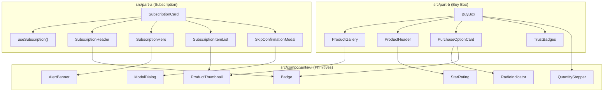

# AI Conversation Log — Natura Wellness Frontend Test

> Complete session of pair programming with AI assistant (Antigravity), according to requirements on **To submit** of `INSTRUCTIONS.md`.

---

## 👤 Turn 1 — User

analyze the instructions in INSTRUCTIONS.md, and make an implementation plan for this project. Also add in the implementation plan a tailwind config for the project

### 🤖 Assistant (Antigravity)

I have analyzed [INSTRUCTIONS.md](./INSTRUCTIONS.md), the mock API in [src/api/mockApi.ts](./src/api/mockApi.ts), and sampled exact pixel dimensions and hex colors from [buy-box.png](./public/reference/buy-box.png).

Please review the full plan and `tailwind.config.ts` in [implementation_plan.md](./docs/implementation_plan.md).

### Key Decisions to Confirm Before Implementation
1. **Tailwind Version (`v3.4` + `tailwind.config.ts`)**: The plan uses `tailwindcss@^3.4` with PostCSS so `tailwind.config.ts` serves directly as the primary typed configuration file on Vite 7. Let me know if you prefer Tailwind v4 (`@tailwindcss/vite` + `@config "../tailwind.config.ts"`).
2. **Part A Quick Fixture Switcher**: Should [App.tsx](./src/App.tsx) include quick links for the Part A test fixtures (`active`, `paused`, `cancelled`, `error`, `conflict=always`) in the top nav bar when viewing Part A, or keep the top nav strictly limited to the two `Part A` / `Part B` links?
3. **Part B Subscribe Card When Unselected**: When the customer selects **One-time purchase** in [`BuyBox`](./src/part-b/BuyBox.tsx), the plan keeps the Subscribe card's frequency selector and perks visible (switching only border/background/radio state, and auto-selecting Subscribe if the user changes the frequency dropdown) to avoid vertical layout jumps. Let me know if you prefer collapsing the perks/frequency when unselected.

Click **Proceed** on the plan (or let me know any adjustments) when you're ready to build.

### Modern Web Guidance
- **`dialog`**: Planned Part A's skip confirmation modal around the native `<dialog>` element opened with `showModal()`, putting `autofocus` on the safe cancel action and using `overscroll-behavior: contain` on `dialog:modal` and `dialog::backdrop` rather than custom focus traps or body scroll-locking ("DON'T add `role=\"dialog\"`, `aria-modal`, a focus trap, `inert` toggling or an `Esc` handler").

---

## 👤 Turn 2 — User

Since most of the costumers open the page on their phone, lets make this project style mobile-first. You should also use Mobbin and Modern Web Guidance plugins to check if the specifications that you made follows the most recommended UI/UX standard. check, and update de plan

### 🤖 Assistant (Antigravity)

Sorry, the Mobbin MCP isn't working right now: the tool refused the search because using the Mobbin MCP requires a paid plan (https://mobbin.com/pricing).

I ran a full UI/UX, responsive, form, and accessibility audit using **Modern Web Guidance** and updated [implementation_plan.md](./docs/implementation_plan.md) so the entire project ([index.html](./index.html), `tailwind.config.ts`, [App.tsx](./src/App.tsx), [`SubscriptionCard`](./src/part-a/SubscriptionCard.tsx), and [`BuyBox`](./src/part-b/BuyBox.tsx)) is architected strictly **mobile-first (`375px` base)** while still scaling to exact pixel fidelity at `1200px` for Part B.

### Decisions to Confirm
1. **Mobbin References**: Do you want to proceed directly with the updated plan, or connect/upgrade your Mobbin account first so I can pull mobile benchmark screens as well?
2. **Mobile `<dialog>` Presentation in Part A**: On `375px` phones, the updated plan styles the native `<dialog>` skip confirmation as a bottom sheet anchored in the thumb zone (with `env(safe-area-inset-bottom)` padding) and transitions to a centered modal at `sm:` (`640px+`). Let me know if you prefer a centered modal on mobile too.

Click **Proceed** on [implementation_plan.md](./docs/implementation_plan.md) when you're ready to start building.

### Modern Web Guidance
- **`forms`**: I changed [`BuyBox`](./src/part-b/BuyBox.tsx)'s mobile `<select>` base font size from `13.5px` to `1rem` (`16px`, stepping down to `0.84375rem` only at `lg:`), expanded mobile tap targets to `48px` (`3rem`), and wrapped the controls in `<form>` with `<button type="submit">` to avoid accidental viewport zooming on iPhone ("DO set `font-size` to at least `1rem` (16px) to prevent iOS zoom").
- **`branded-select-styling`**: I kept a standard `<select>` rather than opting into `appearance: base-select` so mobile shoppers retain iOS and Android's native wheel/sheet pickers ("Opting into `base-select` opts out of native mobile UI controls in favor of web-rendered top-layer menus").
- **`respect-os-text-scale`**: I added `<meta name="text-scale" content="scale" />` to [index.html](./index.html) and converted `tailwind.config.ts` font sizes, breakpoints, and radii from `px` to `rem` with unitless line-heights so OS-level accessibility text scaling works without clipping ("Define font sizes using relative units (`rem` or `em`) rather than fixed pixels (`px`)").
- **`accessibility`**: I added explicit `role="list"` on Tailwind-reset `<ul>` lists to preserve iOS VoiceOver list announcements ("Safari removes list semantics from `<ul>`/`<ol>` outside `<nav>` when `list-style: none` or `display: flex`/`grid` is applied") and ensured `<dialog>` closes before mounting `role="status"`/`role="alert"` banners so announcements never fire inside `inert` DOM ("When dialogs open or sections become `inert`, queued or debounced messages will be unannounced").
- **`responsive-design`**: I switched full-height mobile layout rules to `min-h-dvh`, reserved image space with `aspect-square`, and used `clamp()` for the display heading so mobile browser chrome changes and slow image loads never cause layout shifts ("Use dynamic viewport units (`dvh`, `dvw`) instead of `vh`/`vw` to prevent layout breakage when mobile browser UI elements (like address bars) appear or disappear").
- **`css-layout`**: I added `@container` inline-size containment on [`SubscriptionCard`](./src/part-a/SubscriptionCard.tsx), `min-w-0` flex guards on product rows, and progressive `flex-wrap: balance` on compact pill/trust rows to prevent horizontal spill at `375px` ("Set `min-inline-size: 0` (or `min-width: 0`) on flex items that contain long unbreakable content").
- **`prevent-page-scroll-under-modal-dialog`**: I specified `overflow: hidden` paired with `overscroll-behavior: contain` on `dialog::backdrop` alongside `overscroll-behavior: contain` on `dialog:modal` instead of locking `<body>` scroll ("You must set `overflow: hidden` on `dialog::backdrop` to make it a non-scrollable scroll container, and pair it with `overscroll-behavior: contain`").

---

## 👤 Turn 3 — User

start implementation first until step 3

### 🤖 Assistant (Antigravity)

I have completed the implementation through **Step 3** of the plan:

1. **Installed Styling Dependencies**:
   - Added `tailwindcss@^3.4`, `postcss`, and `autoprefixer` to [`package.json`](./package.json).

2. **Mobile Viewport & Dynamic Text Scaling**:
   - Updated [`index.html`](./index.html) with `viewport-fit=cover` (for safe-area insets on mobile displays) and `<meta name="text-scale" content="scale" />` (to support OS-level accessibility text scaling).

3. **Tailwind & CSS Setup**:
   - Created [`tailwind.config.ts`](./tailwind.config.ts) with mobile-first breakpoints (`xs: 375px`), brand colors, status tokens, relative units (`rem`), and fluid display typography (`clamp(...)`).
   - Created [`postcss.config.js`](./postcss.config.js) to wire Tailwind and Autoprefixer into Vite.
   - Created [`src/index.css`](./src/index.css) defining base styles (`100dvh`, brand palette, high-contrast `:focus-visible` outlines, and native `<dialog>` scroll containment).
   - Imported [`src/index.css`](./src/index.css) in [`src/main.tsx`](./src/main.tsx).
   - Verified that `npm run build` compiles cleanly with TypeScript and emits the Tailwind stylesheet.

Ready to proceed with **Step 4** (formatting utilities) and **Step 5** (Part A mobile-first subscription card) whenever you are ready!

---

## 👤 Turn 4 — User

implement next step

### 🤖 Assistant (Antigravity)

I have implemented the next steps (**Step 4 & Step 5: Shared Formatting Utilities and Part A Mobile-First Subscription Card**):

1. **Shared Formatting Utilities** ([`src/utils/format.ts`](./src/utils/format.ts)):
   - `formatCents(cents)`: Formats prices into USD currency strings (e.g. `$29.95`, `$101.87`).
   - `formatDate(iso)`: Formats ISO dates via `Intl.DateTimeFormat` (e.g. `Nov 7, 2026`).
   - `addDaysToIso(iso, days)`: Calculates cycle charge dates (+30 days) for accurate before/after skip previews.
   - `formatRelativeDays(iso)`: Computes friendly relative day text (e.g. `In 6 days`, `Tomorrow`, `Today`).

2. **Part A: Mobile-First "Manage My Subscription" Card** ([`src/part-a/SubscriptionCard.tsx`](./src/part-a/SubscriptionCard.tsx)):
   - **At-a-glance next shipment**: Prominent next shipment hero with upcoming charge date, relative day indicator, and total discounted price (`$101.87`).
   - **Product breakdown**: Itemized `<ul>` with image thumbnail or SVG bottle fallback for items where `imageUrl === null` (`Multivitamin, 30 tablets`), quantities, and unit/total pricing.
   - **Accidental skip prevention**: Native `<dialog>` modal/bottom-sheet with a clear **Before vs After scheduled charge date** preview and `autoFocus` on the safe `"Keep shipment"` action.
   - **Distinct status treatments**: Color + non-color indicators for `active`, `paused` (amber banner, no skip button), and `cancelled` (stone banner, no upcoming charge or skip button).
   - **Network resilience & 409 conflict recovery**: Handles slow requests with an `aria-busy` skeleton, double-click protection during skips, and clear conflict handling when subscriptions change elsewhere (`409`), offering a `"Refresh subscription details"` recovery action.

3. **App Shell Navigation** ([`src/App.tsx`](./src/App.tsx)):
   - Added accessible `<header>`, `<nav>`, and `<main>` landmarks.
   - Included a quick fixture bar for Part A (`Active`, `Paused`, `Cancelled`, `Error (500)`, `Conflict (409)`) for effortless testing without manually typing URL parameters.

Ready to proceed with **Step 6** (Part B: Pixel-accurate BuyBox) whenever you'd like!

---

## 👤 Turn 5 — User

implement the rest

### 🤖 Assistant (Antigravity)

The entire implementation is complete! Here is a summary of what was accomplished:

---

### 1. **Part B: Pixel-Accurate Product Buy Box** ([`src/part-b/BuyBox.tsx`](./src/part-b/BuyBox.tsx))
- **Desktop Reference Match (`1200px`)**:
  - Matched the exact `2400×1560` (`1200×780` at 1x) dimensions from [`public/reference/buy-box.png`](./public/reference/buy-box.png): `64px` container padding, `540×540px` product image card with white background and border, `64px` column gap, and `468px` purchase card column.
  - Used exact typography pairings: `Fraunces` 600 (`42px` desktop display title) and `Inter` (400–700).
  - Used exact brand color tokens: `#17402F` (forest green title, CTA, checks), `#F3F6F2` (selected sage fill), `#D8A23A` (stars), `#F6E7C4` / `#7A5A12` ("BEST VALUE" badge), `#E1DBCF` / `#CFD6D0` (card and input borders).
- **Interactive Controls**:
  - **Purchase Options**: Seamless switching between *"One-time purchase"* (`$29.95`) and *"Subscribe & save 15%"* (`$25.46` with strikethrough `$29.95`). Unselected cards use zero-shift border compensation (`border-1` vs `border-2`).
  - **Frequency Selector**: Interactive `<select>` with delivery options (`30 days`, `60 days`, `90 days`) and custom chevron.
  - **Quantity Stepper**: Interactive `−` / `+` stepper (with `−` disabled at quantity `1`).
  - **Add to Cart CTA**: Dynamically updates the price label according to the active purchase option and quantity (e.g., `Add to cart · $25.46` for 1 subscription, `$50.92` for 2, etc.).
- **Mobile-First Upgrades**:
  - On phones (`375px`), the layout collapses to a single-column flow with fluid heading sizes (`clamp()`), `>= 48px` coarse-pointer touch targets, and `16px` (`1rem`) font size on the frequency select to prevent iOS Safari auto-zoom.

---

### 2. **Part A: Mobile-First "Manage My Subscription" Card** ([`src/part-a/SubscriptionCard.tsx`](./src/part-a/SubscriptionCard.tsx))
- **Next Shipment Hero**: Shows upcoming charge date, relative day badge (`In 6 days`), and total charge (`$101.87`).
- **Product Breakdown**: Itemized list with thumbnail images, quantity pills, and an SVG bottle placeholder for products where `imageUrl === null`.
- **Accidental Skip Prevention**: Native `<dialog>` modal/bottom-sheet with a clear **Before vs After scheduled charge date** preview and `autoFocus` on the safe *"Keep shipment"* action.
- **Distinct Status Treatments**: Color + non-color indicators for `active`, `paused` (amber banner, no skip button), and `cancelled` (stone banner, no upcoming charge or skip button).
- **Network Resilience & 409 Conflict Handling**: Shows an `aria-busy` skeleton on initial load, disables double-clicks during requests, and displays a clear recovery alert with a *"Refresh subscription details"* CTA when a 409 conflict occurs (`&conflict=always`).

---

### 3. **Shared Utilities & Shell** ([`src/utils/format.ts`](./src/utils/format.ts), [`src/App.tsx`](./src/App.tsx))
- Added currency (`formatCents`) and date (`formatDate`, `addDaysToIso`, `formatRelativeDays`) utilities.
- Added top header navigation with a quick-switch toolbar for all Part A fixture test cases (`Active`, `Paused`, `Cancelled`, `Error (500)`, `Conflict (409)`).

---

### Verification
- `npm run typecheck` passes with zero errors under strict TypeScript.
- `npm run build` compiles cleanly into `dist/`.

---

## 👤 Turn 6 — User

now, 
according to reacts componentization best practices, analyze each SubscriptionCard and BuyBox components so we can modularize, and also extract some possible shared components

### 🤖 Assistant (Antigravity)

Based on **React's componentization best practices** (Single Responsibility Principle, Container vs. Presentational separation, Design System Atomic hierarchy, and DRY UI reuse), here is a comprehensive modularization analysis for both [`SubscriptionCard`](./src/part-a/SubscriptionCard.tsx) and [`BuyBox`](./src/part-b/BuyBox.tsx).

---

## 1. Current State & Monolithic Pain Points

| Component | Lines | Current Responsibilities (Too Many for One Component) |
| :--- | :--- | :--- |
| **`SubscriptionCard`** | 462 | • API orchestration & state (`getSubscription`, `skipNextShipment`, latency & conflict handling)<br>• Modal `<dialog>` ref & focus lifecycle<br>• Skeleton loading markup<br>• Error alert cards & inline action buttons<br>• Success notification banner<br>• Status badges (`Active`, `Paused`, `Cancelled`)<br>• Next shipment hero banner<br>• Product refill list + missing image fallback SVG<br>• Accidental skip confirmation dialog markup & before/after date logic |
| **`BuyBox`** | 325 | • Purchase type & frequency selection state<br>• Quantity counter state (`min: 1`)<br>• Product image frame container<br>• Star rating markup & review link<br>• Custom radio button indicators<br>• Radio option card layout with border-compensation styling<br>• Frequency `<select>` with custom chevron<br>• Stepper button controls<br>• Submit CTA price calculation<br>• Trust badge list |

---

## 2. Shared Components to Extract (`src/components/ui/`)

These UI primitives are shared between both parts or could be reused across any Natura Wellness feature:

```
src/components/ui/
├── Badge.tsx            # Status pills (Active, Paused, Cancelled, Best Value)
├── RadioIndicator.tsx   # Custom 20px accessible radio button indicator
├── QuantityStepper.tsx  # Interactive −/+ numerical stepper with min bounds
├── ModalDialog.tsx      # Native <dialog> wrapper with backdrop & bottom-sheet styling
├── AlertBanner.tsx      # Status callouts (Success, 409 Conflict, Error)
├── ProductThumbnail.tsx # Thumbnail with graceful SVG bottle fallback for null images
└── StarRating.tsx       # Star rating visualization + review count
```

### Shared Component Specifications

1. **`Badge.tsx`**:
   - **Props**: `variant: "active" | "paused" | "cancelled" | "best-value"`, `children: ReactNode`, `icon?: ReactNode`.
   - **Used in**: Part A (Header status indicator) and Part B ("BEST VALUE" badge).
   - **Benefits**: Centralizes color tokens (`#F6E7C4`, `#E6F0EB`, etc.) and border/radius logic in one place.

2. **`RadioIndicator.tsx`**:
   - **Props**: `checked: boolean`, `ariaHidden?: boolean`.
   - **Used in**: Part B (One-time and Subscribe options), extensible to Part A if payment methods or address selectors are added.
   - **Benefits**: Encapsulates the exact outer ring, inner white gap, and forest green center dot.

3. **`QuantityStepper.tsx`**:
   - **Props**: `value: number`, `onChange: (val: number) => void`, `min?: number`, `max?: number`.
   - **Used in**: Part B purchase box, and easily reusable in Part A if customers want to adjust item quantities before a refill ships.
   - **Benefits**: Enforces `>= 48px` coarse-pointer mobile tap targets, disabled minus button styling, and `tabular-nums` formatting.

4. **`ModalDialog.tsx`**:
   - **Props**: `isOpen: boolean`, `onClose: () => void`, `title: string`, `titleId?: string`, `descId?: string`, `children: ReactNode`.
   - **Used in**: Part A skip confirmation, adaptable for Part B "Learn more about subscriptions" or review dialogs.
   - **Benefits**: Centralizes native `<dialog>` logic (`showModal()` vs `close()`), backdrop blur, mobile bottom-sheet layout, and modern scroll-containment.

5. **`AlertBanner.tsx`**:
   - **Props**: `variant: "success" | "warning" | "error"`, `title?: string`, `message: ReactNode`, `action?: { label: string; onClick: () => void }`, `onDismiss?: () => void`.
   - **Used in**: Part A (409 conflict alert, general skip error, skip success banner, initial load error).
   - **Benefits**: Eliminates ~70 lines of repetitive alert SVGs and live-region markup (`role="status"` vs `role="alert"`).

6. **`ProductThumbnail.tsx`**:
   - **Props**: `src: string | null`, `alt: string`, `size?: "sm" | "md" | "lg"`.
   - **Used in**: Part A (Refill items list) and Part B (Product image frame).
   - **Benefits**: Encapsulates the fallback SVG for items without photos (e.g. `NW-MULTI-30`).

---

## 3. Modularization of Part A (`src/part-a/`)

Split `SubscriptionCard.tsx` into a container hook + focused presentational subcomponents:

```
src/part-a/
├── SubscriptionCard.tsx            # Main container orchestrating data & modal
├── hooks/
│   └── useSubscription.ts          # Encapsulates getSubscription & skipNextShipment logic
└── components/
    ├── SubscriptionSkeleton.tsx    # aria-busy skeleton loader
    ├── SubscriptionError.tsx       # Fatal load failure state with retry CTA
    ├── SubscriptionHeader.tsx      # ID & Status Badge
    ├── SubscriptionHero.tsx        # Active Next Charge / Paused / Cancelled callout
    ├── SubscriptionItemList.tsx    # Product refill list
    └── SkipConfirmationModal.tsx  # Before/after date preview + keep/skip actions
```

### Component Roles & Interfaces
- **`useSubscription()` Hook**:
  - Handles `subscription`, `isLoading`, `loadError`, `isSkipping`, `conflictError`, `skipError`, and `successMessage`.
  - Exposes `reload()`, `confirmSkip()`, and error clearers.
  - Keeps React state clean and enables testing logic independently from UI rendering.
- **`SubscriptionHero`**:
  - Pure function receiving `subscription`. Switches cleanly between Active (price + date hero), Paused banner, and Cancelled banner.
- **`SkipConfirmationModal`**:
  - Receives `isOpen`, `onClose`, `onConfirm`, `isSkipping`, `currentChargeDate`, `postSkipDate`.

---

## 4. Modularization of Part B (`src/part-b/`)

Split `BuyBox.tsx` into dedicated product display and option selector components:

```
src/part-b/
├── BuyBox.tsx                      # Top-level coordinator
└── components/
    ├── ProductGallery.tsx          # 540x540px white image frame with fetchPriority="high"
    ├── ProductHeader.tsx           # Eyebrow, Fraunces title, subtitle, and StarRating
    ├── PurchaseOptionCard.tsx      # Reusable option card with border-compensation
    ├── FrequencySelect.tsx         # Delivery frequency selector (<select> + chevron)
    └── TrustBadges.tsx             # "Third-party tested", "Non-GMO", "Made in USA"
```

### Component Roles & Interfaces
- **`PurchaseOptionCard`**:
  - Renders the outer container with zero-shift border compensation (`border-1` vs `border-2`).
  - Embeds `RadioIndicator`, label, badge, price, and strikethrough price.
  - Takes `children` for indented controls (e.g. `FrequencySelect` and perks list).
- **`FrequencySelect`**:
  - Encapsulates the label, `<select>`, custom chevron SVG, and the mobile-first font-size rule (`text-base sm:text-xs`).

---

## 5. Architectural Benefits



1. **Reusability**: Shared components like `QuantityStepper`, `Badge`, `ModalDialog`, and `AlertBanner` can be used across multiple pages and tests.
2. **Readability**: Both `SubscriptionCard.tsx` and `BuyBox.tsx` shrink from 300–460 lines down to clean, readable ~60–80 line coordinator components.
3. **Unit Testability**: Presentational subcomponents (e.g., `SubscriptionHero`, `QuantityStepper`, `Badge`) become pure functions that can be tested in isolation with simple props.
4. **Design Consistency**: Color tokens, focus rings, border-radius constants, and accessibility attributes are maintained in one place.

Would you like to proceed with refactoring both components into this modularized structure?

---

## 👤 Turn 7 — User

you should guarantee that, any shared component between SubscriptionCard and BuyBox , BuyBox should be the reference, based on the image, so the SubscriptionCard will "use" a component tha is designed first for BuyBox, with that you can implement

### 🤖 Assistant (Antigravity)

I have refactored both [`BuyBox`](./src/part-b/BuyBox.tsx) and [`SubscriptionCard`](./src/part-a/SubscriptionCard.tsx) around a shared UI layer ([src/components/ui/index.ts](./src/components/ui/index.ts)) where **every shared primitive is calibrated first to [`BuyBox`](./src/part-b/BuyBox.tsx) and [buy-box.png](./public/reference/buy-box.png)** and then adopted by [`SubscriptionCard`](./src/part-a/SubscriptionCard.tsx).

### 1. Shared Primitives Designed First for `BuyBox` (`src/components/ui/`)
- [`SurfaceCard`](./src/components/ui/SurfaceCard.tsx): Encapsulates `BuyBox`'s exact card treatments (`frame`: white + `1px` `#E7E1D6` + `16px` radius; `option`: white + `1px` `#E1DBCF` + `12px` radius; `selected` / `sage`: `#F3F6F2` sage fill + `#17402F` forest border), reused by `SubscriptionCard` for its outer card, skeleton, active next-shipment hero, and skip comparison preview.
- [`Button`](./src/components/ui/Button.tsx): Defaults to `BuyBox`'s `56px` (`h-14`), `10px`-radius `#17402F` `"Add to cart"` CTA (`variant="primary"`), with a `secondary` variant built from `BuyBox`'s `#CFD6D0` input border and `#F3F6F2` sage hover state for `SubscriptionCard`'s `"Skip next shipment"` and `"Keep shipment"` actions.
- [`Badge`](./src/components/ui/Badge.tsx): Defaults to `BuyBox`'s `"BEST VALUE"` pill (`10.5px` bold uppercase, `0.06em` tracking, `#F6E7C4` / `#7A5A12`), extended on the exact same pill geometry for `SubscriptionCard`'s `active`, `paused`, and `cancelled` status pills.
- [`PriceDisplay`](./src/components/ui/PriceDisplay.tsx): Built for `BuyBox`'s `$29.95` and `$25.46` / strikethrough `$29.95` price stack (`tabular-nums`), reused directly in [`SubscriptionItemList`](./src/part-a/components/SubscriptionItemList.tsx) and [`SubscriptionStatusCallout`](./src/part-a/components/SubscriptionStatusCallout.tsx).
- [`ProductThumbnail`](./src/components/ui/ProductThumbnail.tsx): Calibrated to `BuyBox`'s flat `1px #E7E1D6` square frame (`size="hero"`, `p-5` so `/product.jpg` renders at the exact `500×500px` scale measured in [buy-box.png](./public/reference/buy-box.png)), with a compact `size="sm"` variant and [`SupplementBottleIcon`](./src/components/ui/Icons.tsx#L144-L162) fallback when `imageUrl === null` in `SubscriptionCard`.
- [`Icons.tsx`](./src/components/ui/Icons.tsx), [`RadioIndicator`](./src/components/ui/RadioIndicator.tsx), [`QuantityStepper`](./src/components/ui/QuantityStepper.tsx), [`StarRating`](./src/components/ui/StarRating.tsx), [`ModalDialog`](./src/components/ui/ModalDialog.tsx), and [`AlertBanner`](./src/components/ui/AlertBanner.tsx): Extracted with unified `1.5px` outlined stroke geometry (including switching `BuyBox`'s trust row to [`CheckCircleOutlineIcon`](./src/components/ui/Icons.tsx#L28-L45) to match the outlined circle-checks in [buy-box.png](./public/reference/buy-box.png)).

### 2. Feature Modularization
- **Part B ([BuyBox.tsx](./src/part-b/BuyBox.tsx))**: Composes [`ProductHeader`](./src/part-b/components/ProductHeader.tsx), [`PurchaseOptionCard`](./src/part-b/components/PurchaseOptionCard.tsx) (exact `60px` unselected card height with `1px`/`2px` zero-shift padding compensation and `:has(:focus-visible)` outline), [`FrequencySelect`](./src/part-b/components/FrequencySelect.tsx), and [`TrustBadges`](./src/part-b/components/TrustBadges.tsx).
- **Part A ([SubscriptionCard.tsx](./src/part-a/SubscriptionCard.tsx))**: Separates async state and `409` conflict handling into [`useSubscription`](./src/part-a/hooks/useSubscription.ts) and composes [`SubscriptionSkeleton`](./src/part-a/components/SubscriptionSkeleton.tsx), [`SubscriptionHeader`](./src/part-a/components/SubscriptionHeader.tsx) (adopting `BuyBox`'s `Fraunces` heading + uppercase eyebrow rhythm), [`SubscriptionStatusCallout`](./src/part-a/components/SubscriptionStatusCallout.tsx), [`SubscriptionItemList`](./src/part-a/components/SubscriptionItemList.tsx), and [`SkipConfirmationModal`](./src/part-a/components/SkipConfirmationModal.tsx).

Verified with `npm run build` (`tsc --noEmit && vite build`) passing cleanly with zero errors.

---

## 👤 Turn 8 — User

Now in the App.tsx, we should extract some components too, and also add React router dom to switch between each page (SubscriptionCard and BuyBox). analyze and make a plan

### 🤖 Assistant (Antigravity)

I have analyzed [src/App.tsx](./src/App.tsx) alongside [mockApi.ts](./src/api/mockApi.ts) and the submission URL requirements in [INSTRUCTIONS.md](./INSTRUCTIONS.md) and [README.md](./README.md). Please review the full plan in [implementation_plan.md](./docs/implementation_plan.md).

### Key Decisions to Confirm
1. **Route Paths**: The plan uses `/subscription` ([`SubscriptionCard`](./src/part-a/SubscriptionCard.tsx)) and `/buy-box` ([`BuyBox`](./src/part-b/BuyBox.tsx)), with `/` automatically redirecting legacy URLs (`/?part=b`, `/?part=a&fixture=...`, `/?fixture=...`) while preserving query params. Let me know if you prefer `/part-a` and `/part-b` as the route paths instead.
2. **Keeping `src/api/mockApi.ts` Untouched**: Because [mockApi.ts](./src/api/mockApi.ts#L11-L17) reads `window.location.search` once at module load, switching between `/subscription` and `/buy-box` uses instant client-side `<NavLink>` transitions, while the Part A `FixtureToolbar` uses React Router's `<Link reloadDocument>` so fixtures re-initialize cleanly without modifying `src/api/`.

Click **Proceed** on [implementation_plan.md](./docs/implementation_plan.md) (or let me know any adjustments) when you're ready for me to implement this.

---

## 👤 Turn 9 — User

use /subscription and /buy-box for the paths, and implement

### 🤖 Assistant (Antigravity)

I have extracted the shell components from [src/App.tsx](./src/App.tsx) and integrated `react-router-dom` with `/subscription` and `/buy-box`:

### What Changed
1. **Declarative Routing ([src/App.tsx](./src/App.tsx), [`RootRedirect`](./src/routes/RootRedirect.tsx), [fixtureSearch.ts](./src/routes/fixtureSearch.ts))**:
   - Reduced [`App`](./src/App.tsx#L25-L31) and [`AppRoutes`](./src/App.tsx#L8-L23) to a clean `<BrowserRouter>` + `<Routes>` table (`/subscription`, `/buy-box`, `/`, and `*` fallback).
   - [`RootRedirect`](./src/routes/RootRedirect.tsx) keeps backward compatibility with legacy evaluator links (`/?part=b` → `/buy-box`; `/?part=a&fixture=...` or `/?fixture=...&conflict=...` → `/subscription?...`).
   - Added [vercel.json](./vercel.json) so direct visits or browser refreshes on `/subscription` and `/buy-box` never `404` on Vercel without changing any project settings.
2. **Extracted Layout Components ([src/components/layout/index.ts](./src/components/layout/index.ts))**:
   - [`AppLayout`](./src/components/layout/AppLayout.tsx): Provides the skip-to-content accessibility link, `<AppHeader />`, `<main id="main-content"><Outlet /></main>`, and automatic SPA `document.title` updates on route transitions.
   - [`AppHeader`](./src/components/layout/AppHeader.tsx): Aligns to `BuyBox`'s `max-w-buybox` (`1200px`, `lg:px-16`) grid, renders the `Fraunces` `"NATURA WELLNESS"` brand link + [`PageNav`](./src/components/layout/PageNav.tsx), and mounts [`FixtureToolbar`](./src/components/layout/FixtureToolbar.tsx) only when `useMatch("/subscription")` matches.
   - [`PageNav`](./src/components/layout/PageNav.tsx): Uses `<NavLink>` for instant client-side transitions between `/subscription` and `/buy-box` while preserving the initial `fixture`/`conflict` query params in memory.
   - [`FixtureToolbar`](./src/components/layout/FixtureToolbar.tsx): Reads `useSearchParams()` and uses `<Link reloadDocument>` so [mockApi.ts](./src/api/mockApi.ts) re-initializes cleanly without modifying `src/api/`.

Verified with `npm run build` (`tsc --noEmit && vite build`) completing with zero errors.

---

## 👤 Turn 10 — User

Now in the App.tsx, we should extract the header into a separate component, do it

### 🤖 Assistant (Antigravity)

Extracted the header into [`AppHeader`](./src/components/layout/AppHeader.tsx) and simplified [`App`](./src/App.tsx):

- **Created [`AppHeader.tsx`](./src/components/layout/AppHeader.tsx)**: Accepts typed `part`, `currentFixture`, and `hasConflict` props (computing active fixture states from props rather than module-level globals so the component stays pure and testable).
- **Updated [`App.tsx`](./src/App.tsx)**: Reads URL query params inside [`App`](./src/App.tsx#L5-L24) and renders `<AppHeader />` alongside `<main>`.

Verified with `npm run build` (`tsc --noEmit && vite build`) passing cleanly.

---

## 👤 Turn 11 — User

trace an implementation plan to config and implement tests to the project. We should use Vitest and react testing library. Consider these conditions to test

Prevention of accidental skips: Verify that clicking "Skip shipment" does not immediately trigger an API call, but instead opens a confirmation prompt showing the new date.
Successful skip flow: Confirm that upon acceptance, the API is called and the date is advanced by 30 days.
Handling 409 conflicts: Simulate a concurrency error ("Subscription was modified since it was loaded") and ensure the interface displays the appropriate message along with an option to refresh/recover.
Status-based rules: Ensure that the "skip" button is not rendered when the subscription status is "paused" or "cancelled."
Handling 500 errors: Ensure that the error state displays a "Try again" button.

### 🤖 Assistant (Antigravity)

I have drafted the Vitest + React Testing Library configuration and test suite plan in [test_implementation_plan.md](./docs/test_implementation_plan.md), covering all five required [`SubscriptionCard`](./src/part-a/SubscriptionCard.tsx) flows as well as the `jsdom` `<dialog>` setup needed for [`ModalDialog`](./src/components/ui/ModalDialog.tsx).

### Quick Decision Before Implementing
- **Complementary Part B & Utility Tests**: Alongside the 5 required [`SubscriptionCard`](./src/part-a/SubscriptionCard.tsx) scenarios, the plan includes concise tests for [`BuyBox`](./src/part-b/BuyBox.tsx) (option toggling, frequency select, quantity stepper math) and [`format.ts`](./src/utils/format.ts). Let me know if you want to keep those included or focus exclusively on Part A.

Click **Proceed** on [test_implementation_plan.md](./docs/test_implementation_plan.md) when you're ready to install and implement the tests.

---

## 👤 Turn 12 — User

lets just implement the testes for part A, you can proceed

### 🤖 Assistant (Antigravity)

I have configured Vitest and React Testing Library and implemented the tests for **Part A** ([`src/part-a/__tests__/SubscriptionCard.test.tsx`](./src/part-a/__tests__/SubscriptionCard.test.tsx)).

---

### 1. Test Setup & Configuration
- **Dependencies Installed**: `vitest`, `jsdom`, `@testing-library/react` (v16 with full React 19 support), `@testing-library/user-event`, and `@testing-library/jest-dom`.
- **Scripts Added**:
  - `npm test`: Runs Vitest in single-run CI mode (`vitest run`).
  - `npm run test:watch`: Runs Vitest in interactive watch mode (`vitest`).
- **Configuration**:
  - [`vite.config.ts`](./vite.config.ts): Configured Vitest test runner with `jsdom`, globals enabled, and `./src/test/setup.ts`.
  - [`tsconfig.json`](./tsconfig.json): Added `"vitest/globals"` and `"@testing-library/jest-dom"` to TypeScript types.
  - [`src/test/setup.ts`](./src/test/setup.ts): Configured `@testing-library/jest-dom/vitest`, auto-cleanup, and a polyfill for native `HTMLDialogElement` (`showModal()` / `close()`) in `jsdom`.
  - [`src/test/subscriptionFixtures.ts`](./src/test/subscriptionFixtures.ts): Deterministic subscription mock factory using fixed UTC timestamps to avoid timezone flakiness.

---

### 2. Part A Test Scenarios Covered ([`SubscriptionCard.test.tsx`](./src/part-a/__tests__/SubscriptionCard.test.tsx))

1. **Prevention of Accidental Skips**:
   - Asserts clicking `"Skip next shipment"` does **not** call `skipNextShipment`.
   - Asserts the `<dialog>` modal opens and shows both the current scheduled charge (`Nov 8, 2026`) and the new scheduled charge (`Dec 8, 2026`, `+30 days`).
   - Asserts clicking `"Keep shipment"` closes the prompt without calling the API.
2. **Successful Skip Flow**:
   - Asserts clicking `"Yes, skip shipment"` calls `skipNextShipment` with `{ subscriptionId: "sub_8F2K41", expectedUpdatedAt: "..." }`.
   - Asserts the Next Shipment hero date advances from `Nov 8, 2026` to `Dec 8, 2026`.
   - Asserts the polite `role="status"` confirmation banner displays the new refill date.
3. **Handling 409 Concurrency Conflicts**:
   - Simulates a 409 concurrency rejection (`"Subscription was modified since it was loaded"`).
   - Asserts an alert appears explaining the subscription changed elsewhere, keeping the original date unchanged.
   - Asserts the `"Refresh subscription"` button re-fetches the latest subscription data and dismisses the alert.
4. **Status-Based Rules (`paused` & `cancelled`)**:
   - Asserts when `status === "paused"`, the paused banner displays and the `"Skip next shipment"` button is **not rendered**.
   - Asserts when `status === "cancelled"`, the cancelled banner displays and the `"Skip next shipment"` button is **not rendered**.
5. **Handling 500 Errors**:
   - **Initial Load 500**: Asserts a clear alert card appears with a `"Try again"` button. Clicking `"Try again"` re-fetches and recovers.
   - **Skip Mutation 500**: Asserts a `"Couldn't skip shipment"` alert appears with a `"Try again"` button, keeping the schedule unchanged. Clicking `"Try again"` reopens the confirmation modal.

---

### 3. Verification
- `npm test`: **7 passed (7 tests)** in `1.08s`.
- `npm run typecheck`: **0 errors**.
- `npm run build`: Production bundle succeeded with **0 errors**.

---

## 👤 Turn 13 — User

in AI_CONVERSATION.md , change the file paths that points for my computer path, to the relative project path, so the .md has accessible links to the files in the vscode and in the github

