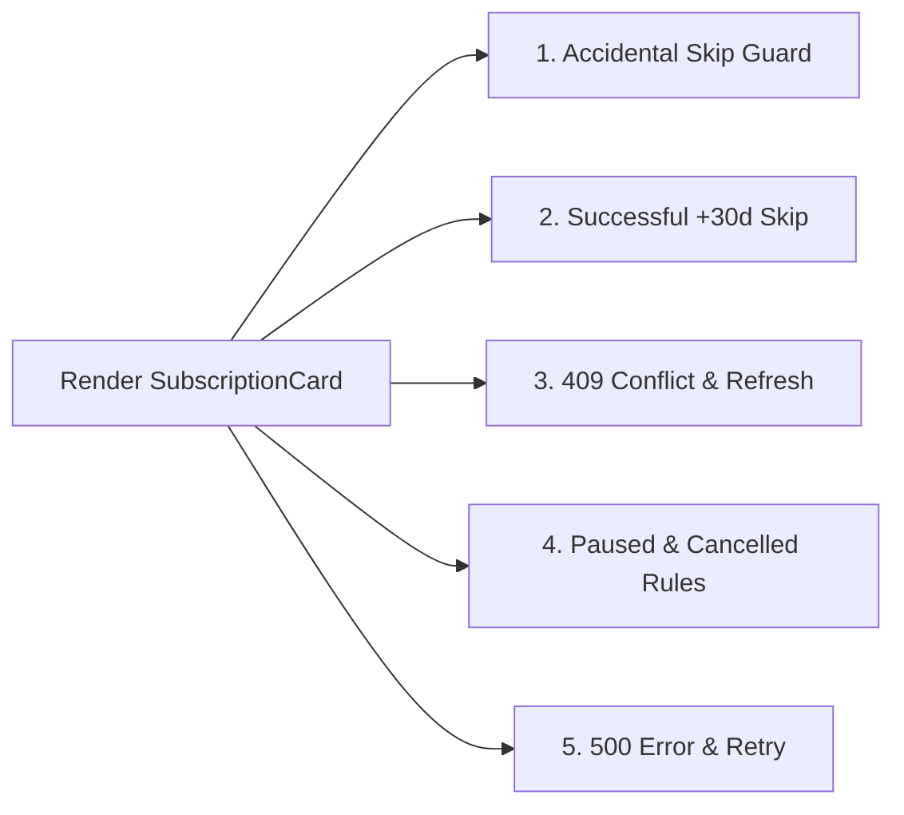

# Test Suite Implementation Plan (Vitest + React Testing Library)

## 1. Testing Stack & Compatibility Analysis

The project runs on **Vite 7 + React 19 + TypeScript 5.8 (`strict: true`)**. To ensure zero version conflicts and reliable user-centric DOM testing:

| Package | Role | Why This Version / Choice |
| :--- | :--- | :--- |
| `vitest` | Test runner & assertion/mocking engine (`vi`) | Shares Vite 7's transform pipeline directly via `vite.config.ts`. |
| `jsdom` | Browser DOM environment | Lightweight DOM runtime for component & hook rendering. |
| `@testing-library/react` (`^16`) | Component rendering & screen queries | v16+ includes official **React 19** `act()` and `createRoot` support. |
| `@testing-library/user-event` (`^14`) | Realistic pointer & keyboard interactions | Simulates real click, focus, and keyboard events rather than synthetic `fireEvent`. |
| `@testing-library/jest-dom` (`^6`) | Accessible DOM matchers | Provides `.toBeInTheDocument()`, `.toBeDisabled()`, `.toHaveAttribute()`, etc. via `@testing-library/jest-dom/vitest`. |

> [!IMPORTANT]
> **Native `<dialog>` Polyfill for `jsdom`**: [`ModalDialog.tsx`](file:///c:/Users/jadil/OneDrive/Documentos/Currículo/desafios/natura-wellness-frontend-test/src/components/ui/ModalDialog.tsx) uses native `HTMLDialogElement.prototype.showModal()` and `.close()`. Because `jsdom` does not implement `showModal()`/`close()` natively, we will include a small shim in `src/test/setup.ts` that toggles the `open` attribute and dispatches the `"close"` event so `screen.getByRole("dialog")` and inner modal buttons work identically to real browsers.

---

## 2. Configuration Plan

### Step 1 — Install Test Dependencies & Scripts
```bash
npm install -D vitest jsdom @testing-library/react @testing-library/user-event @testing-library/jest-dom
```

Update [package.json](file:///c:/Users/jadil/OneDrive/Documentos/Currículo/desafios/natura-wellness-frontend-test/package.json) `scripts`:
- `"test"`: `"vitest run"` (CI-friendly single run)
- `"test:watch"`: `"vitest"` (interactive watch mode)

### Step 2 — Configure `vite.config.ts` & `tsconfig.json`
- **[vite.config.ts](file:///c:/Users/jadil/OneDrive/Documentos/Currículo/desafios/natura-wellness-frontend-test/vite.config.ts)**: Import `defineConfig` from `"vitest/config"` and add:
  ```ts
  test: {
    environment: "jsdom",
    globals: true,
    setupFiles: ["./src/test/setup.ts"],
    css: false,
  }
  ```
- **[tsconfig.json](file:///c:/Users/jadil/OneDrive/Documentos/Currículo/desafios/natura-wellness-frontend-test/tsconfig.json)**: Add `"vitest/globals"` and `"@testing-library/jest-dom"` to `compilerOptions.types` so `npm run typecheck` (`tsc --noEmit`) validates all `.test.ts` / `.test.tsx` files strictly.

### Step 3 — Create Test Setup & Fixture Helpers (`src/test/`)
- **`src/test/setup.ts`**:
  - Import `"@testing-library/jest-dom/vitest"`.
  - Run `cleanup()` in `afterEach` and `vi.clearAllMocks()`.
  - Shim `HTMLDialogElement.prototype.showModal` and `HTMLDialogElement.prototype.close` on `jsdom`.
- **`src/test/subscriptionFixtures.ts`**:
  - Deterministic factory `makeSubscription(overrides?: Partial<Subscription>)` using fixed UTC noon timestamps (e.g., `nextChargeAt: "2026-11-08T12:00:00.000Z"` → `"Nov 8, 2026"`, `+30 days` → `"2026-12-08T12:00:00.000Z"` → `"Dec 8, 2026"`) so date assertions never flake across local timezones or midnight boundaries.

---

## 3. Planned Test Suites & Scenarios

### A. Part A Required Scenarios — `src/part-a/__tests__/SubscriptionCard.test.tsx`

Mocks [mockApi.ts](file:///c:/Users/jadil/OneDrive/Documentos/Currículo/desafios/natura-wellness-frontend-test/src/api/mockApi.ts) (`vi.mock("../../api/mockApi")`) to eliminate the `400–2500ms` artificial sleep and random `33%` conflict rate, testing [`SubscriptionCard`](file:///c:/Users/jadil/OneDrive/Documentos/Currículo/desafios/natura-wellness-frontend-test/src/part-a/SubscriptionCard.tsx) end-to-end with `userEvent.setup()`:



| # | Required Condition | Test Steps & Exact Assertions |
| :--- | :--- | :--- |
| **1** | **Prevention of accidental skips** | 1. Resolve `getSubscription()` with an `active` subscription (`nextChargeAt`: `Nov 8, 2026`, `intervalDays: 30`).<br>2. Click `"Skip next shipment"`.<br>3. Assert `skipNextShipment` has **not** been called (`expect(skipNextShipment).not.toHaveBeenCalled()`).<br>4. Assert `<dialog>` (`getByRole("dialog", { name: /skip your next shipment\?/i })`) is visible and shows both `Nov 8, 2026` (current) and **`Dec 8, 2026`** (new `+30d` date).<br>5. Click `"Keep shipment"` → assert dialog closes and `skipNextShipment` is still never called. |
| **2** | **Successful skip flow** | 1. Resolve `getSubscription()` with `active` (`Nov 8, 2026`, `updatedAt: "2026-11-01T12:00:00.000Z"`).<br>2. Mock `skipNextShipment()` resolving with `nextChargeAt` advanced by 30 days (`Dec 8, 2026`).<br>3. Click `"Skip next shipment"`, then click `"Yes, skip shipment"` inside the dialog.<br>4. Assert `skipNextShipment` was called once with `{ subscriptionId: "sub_8F2K41", expectedUpdatedAt: "2026-11-01T12:00:00.000Z" }`.<br>5. Assert dialog closes, the Next Shipment hero updates from `Nov 8, 2026` to **`Dec 8, 2026`**, and the `role="status"` confirmation banner announces `Dec 8, 2026`. |
| **3** | **Handling `409` conflicts** | 1. Resolve `getSubscription()` with `active` (`Nov 8, 2026`).<br>2. Mock `skipNextShipment()` rejecting with `new ApiError(409, "Subscription was modified since it was loaded")`.<br>3. Click `"Skip next shipment"` → `"Yes, skip shipment"`.<br>4. Assert `role="alert"` warning banner appears explaining the subscription changed elsewhere, the card still displays `Nov 8, 2026`, and a **`"Refresh subscription"`** button is rendered.<br>5. Queue a fresh `getSubscription()` response, click `"Refresh subscription"`, and assert `getSubscription` is called a second time and the conflict alert clears. |
| **4** | **Status-based rules (`paused` & `cancelled`)** | • **`paused` test**: Resolve `getSubscription()` with `status: "paused"`, `pausedUntil: "2026-11-26T12:00:00.000Z"`. Assert `Paused` badge and `Paused until Nov 26, 2026` render, and `queryByRole("button", { name: /skip/i })` is **`null`**.<br>• **`cancelled` test**: Resolve `getSubscription()` with `status: "cancelled"`, `cancelledAt: "2026-10-23T12:00:00.000Z"`. Assert `Cancelled` badge and `Cancelled on Oct 23, 2026` render, no upcoming charge block is shown, and `queryByRole("button", { name: /skip/i })` is **`null`**. |
| **5** | **Handling `500` errors** | • **Initial load `500` test**: Reject `getSubscription()` with `new ApiError(500, "Internal server error")`. Assert `role="alert"` renders the error message and a **`"Try again"`** button (`getByRole("button", { name: /try again/i })`). Click `"Try again"` after mocking a resolved response and verify the card recovers.<br>• **Skip mutation `500` test**: Reject `skipNextShipment()` with `new ApiError(500, "Internal server error")`. Assert `role="alert"` renders `"Couldn't skip shipment"` with a **`"Try again"`** button while preserving the original charge date. |

---

### B. Complementary Coverage (Part B & Shared Utilities)

To ensure full confidence across the whole repository without adding bloat:
1. **`src/part-b/__tests__/BuyBox.test.tsx`**:
   - Renders default `"Subscribe & save 15%"` selection with `Add to cart · $25.46`.
   - Toggles to `"One-time purchase"` and verifies CTA updates to `Add to cart · $29.95`.
   - Verifies quantity stepper (`−` disabled at `1`, clicking `+` updates CTA total to `$50.92` / `$59.90`, clicking `−` decrements back).
   - Verifies changing delivery frequency `<select>` (`60 days`) updates value and selects Subscribe if One-time was active.
2. **`src/utils/__tests__/format.test.ts`**:
   - Unit tests `formatCents`, `formatDate`, and `addDaysToIso` (`+30 days` math).

---

## 4. Planned File Changes Summary

| File | Action | Purpose |
| :--- | :--- | :--- |
| [package.json](file:///c:/Users/jadil/OneDrive/Documentos/Currículo/desafios/natura-wellness-frontend-test/package.json) | Modify | Add `vitest`, `jsdom`, `@testing-library/*` devDependencies + `test` / `test:watch` scripts. |
| [vite.config.ts](file:///c:/Users/jadil/OneDrive/Documentos/Currículo/desafios/natura-wellness-frontend-test/vite.config.ts) | Modify | Add `test` block (`environment: "jsdom"`, `globals: true`, `setupFiles`). |
| [tsconfig.json](file:///c:/Users/jadil/OneDrive/Documentos/Currículo/desafios/natura-wellness-frontend-test/tsconfig.json) | Modify | Add `"vitest/globals"` and `"@testing-library/jest-dom"` types. |
| `src/test/setup.ts` | Create | Register `jest-dom` matchers, cleanup hooks, and native `<dialog>` `jsdom` polyfill. |
| `src/test/subscriptionFixtures.ts` | Create | Deterministic UTC-noon `Subscription` builders for timezone-safe tests. |
| `src/part-a/__tests__/SubscriptionCard.test.tsx` | Create | All 5 required Part A integration test suites + recovery flows. |
| `src/part-b/__tests__/BuyBox.test.tsx` | Create | Part B option switching, frequency select, and quantity stepper pricing math tests. |
| `src/utils/__tests__/format.test.ts` | Create | Unit tests for currency and date helpers. |

---

## 5. Verification Steps

1. Run `npm test` (`vitest run`) and confirm 100% of test suites pass cleanly and deterministically.
2. Run `npm run typecheck` and `npm run build` to ensure test TypeScript globals and production builds coexist with zero errors.
